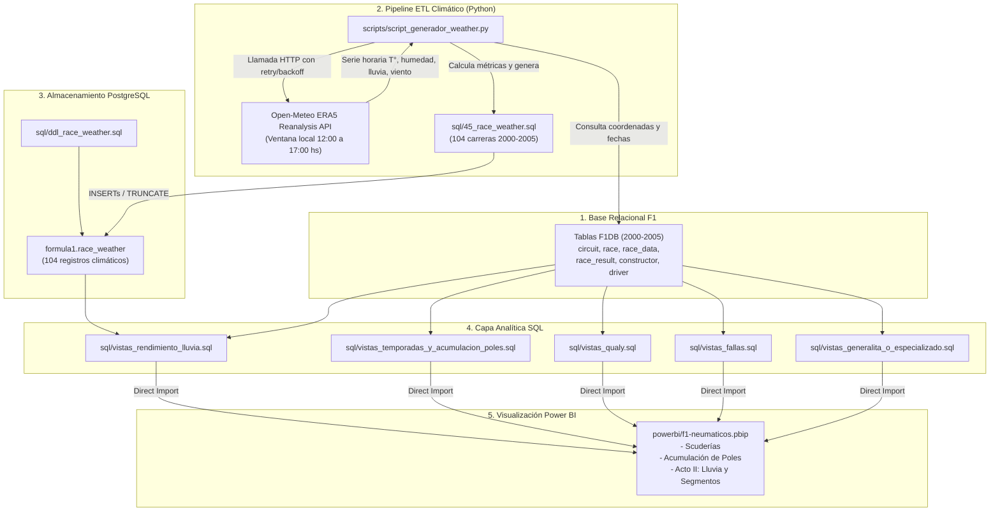

# Guía de Replicación del Modelo de Datos y Enriquecimiento Climático (F1 2000-2005)

Esta guía documenta el procedimiento paso a paso para reproducir de forma exacta y determinística el modelo de datos del proyecto **F1 Tyre War (2000-2005)**, integrando la base relacional de Fórmula 1, el pipeline ETL de enriquecimiento climático histórico (Open-Meteo ERA5), las vistas analíticas en PostgreSQL y el modelo semántico en Power BI.

---

## 1. Arquitectura del Flujo de Datos



---

## 2. Requisitos Previos

### 2.1 Software Requerido
1. **PostgreSQL 14 o superior** (probado en PostgreSQL 18) en ejecución en `localhost:5432`.
2. **Python 3.8+** con `pip`.
3. **Power BI Desktop** (para abrir el proyecto en formato `.pbip`).

### 2.2 Librerías de Python
Instala las dependencias necesarias con:

```bash
pip install psycopg2-binary requests urllib3
```

> [!NOTE]
> Se recomienda `psycopg2-binary` para evitar requerir herramientas de compilación C++ en Windows.

### 2.3 Credenciales por Defecto de PostgreSQL
Los scripts del proyecto utilizan la configuración estándar de la cátedra:
* **Host:** `localhost`
* **Puerto:** `5432`
* **Base de datos:** `postgres`
* **Usuario:** `postgres`
* **Contraseña:** `postgresql` *(notar la 'l' al final)*
* **Esquema:** `formula1`

---

## 3. Estructura de Archivos del Proyecto

| Archivo | Ubicación | Descripción |
| :--- | :--- | :--- |
| `script_generador_weather.py` | [scripts/script_generador_weather.py](../scripts/script_generador_weather.py) | Pipeline Python ETL que consulta Open-Meteo y genera el SQL climático. |
| `ddl_race_weather.sql` | [sql/ddl_race_weather.sql](../sql/ddl_race_weather.sql) | DDL para crear la tabla `formula1.race_weather` con claves foráneas e índices. |
| `45_race_weather.sql` | [sql/45_race_weather.sql](../sql/45_race_weather.sql) | Datos climáticos precalculados (104 registros de Grandes Premios 2000-2005). |
| `vistas_rendimiento_lluvia.sql` | [sql/vistas_rendimiento_lluvia.sql](../sql/vistas_rendimiento_lluvia.sql) | Vistas SQL que cruzan clima con tiempos por vuelta de Michelin y Bridgestone. |
| `vistas_temporadas_y_acumulacion_poles.sql` | [sql/vistas_temporadas_y_acumulacion_poles.sql](../sql/vistas_temporadas_y_acumulacion_poles.sql) | Vistas cronológicas de poles, victorias y podios por temporada. |
| `vistas_qualy.sql` | [sql/vistas_qualy.sql](../sql/vistas_qualy.sql) | Brechas de ritmo a una vuelta en clasificación. |
| `vistas_fallas.sql` | [sql/vistas_fallas.sql](../sql/vistas_fallas.sql) | Análisis de fiabilidad y causas de abandono mecánico vs neumáticos. |
| `vistas_generalita_o_especializado.sql` | [sql/vistas_generalita_o_especializado.sql](../sql/vistas_generalita_o_especializado.sql) | Asimetría Ferrari vs clientes en el campamento Bridgestone. |
| `f1-neumaticos.pbip` | [powerbi/f1-neumaticos.pbip](../powerbi/f1-neumaticos.pbip) | Proyecto Power BI con el informe y modelo analítico completo. |

---

## 4. Paso a Paso para Reproducir el Modelo

### Paso 1: Crear el Esquema y Cargar los Datos Base de F1
Si partes de una base de datos PostgreSQL limpia:
1. Conéctate a PostgreSQL y asegúrate de que el esquema `formula1` exista:
   ```sql
   CREATE SCHEMA IF NOT EXISTS formula1;
   ```
2. Ejecuta los scripts de la cátedra desde `00_estructura.sql` hasta `44_race_constructor_standing.sql` o ejecuta el archivo batch oficial:
   ```cmd
   cd "C:\ruta\a\scripts_catedra"
   cargar_todo.bat
   ```

---

### Paso 2: Crear la Tabla `race_weather` en PostgreSQL
Ejecuta el archivo DDL para crear la tabla de clima con su clave foránea hacia `race(id)`:

```cmd
psql -h localhost -p 5432 -U postgres -d postgres -f "sql\ddl_race_weather.sql"
```

> [!TIP]
> **Detalle del Parche de Foreign Keys:**  
> Si usas el script `cargar_todo.bat` de la cátedra para reconstruir la base completa desde cero, `00_estructura.sql` originalmente no eliminaba `race_weather` antes de eliminar `race`.  
> El script `script_generador_weather.py` incluye en su **Paso 1** la verificación y parche automático de `00_estructura.sql` agregando `DROP TABLE IF EXISTS "race_weather";` para permitir re-ejecuciones limpias.

---

### Paso 3: Ejecutar el Pipeline ETL de Clima (`script_generador_weather.py`)
El script se encarga de:
1. **[Paso 1/5]** Verificar y asegurar el orden de `DROP TABLE` en `00_estructura.sql`.
2. **[Paso 2/5]** Conectar a PostgreSQL para obtener el listado de las 104 carreras (2000-2005) junto con las coordenadas GPS del circuito (`latitude`, `longitude`) y fecha oficial.
3. **[Paso 3/5]** Probar la disponibilidad de la API histórica de Open-Meteo.
4. **[Paso 4/5]** Descargar la serie horaria para cada Gran Premio, aislando la ventana de carrera (**12:00 a 17:00 hora local**) y calculando:
   - Temperatura media, máxima y mínima (`air_temp_avg`, `air_temp_max`, `air_temp_min`).
   - Humedad relativa media (`relative_humidity_pct`).
   - Precipitación acumulada (`precipitation_total_mm`).
   - Viento máximo (`wind_speed_max_kmh`).
   - Código WMO dominante (`weather_code`).
   - Criterio booleano de lluvia (`is_wet_race = TRUE` si la precipitación supera 0.5 mm o el código WMO corresponde a llovizna, lluvia o tormenta).
5. **[Paso 5/5]** Generar y validar el archivo `45_race_weather.sql` con los 104 `INSERT` correspondientes.

#### Para ejecutarlo:
```bash
python scripts/script_generador_weather.py
```

#### Opciones avanzadas del script:
```bash
# Si tus scripts de cátedra están en otra carpeta:
python scripts/script_generador_weather.py --scripts-dir "C:\ruta\a\scripts"

# Si usas una contraseña o puerto diferente:
python scripts/script_generador_weather.py --password "mi_password" --port 5432

# Omitir el parche de 00_estructura.sql si ya gestionas las tablas:
python scripts/script_generador_weather.py --skip-patch
```

---

### Paso 4: Cargar los Datos Climáticos en PostgreSQL
Una vez generado el archivo `45_race_weather.sql` (o usando directamente la copia provista en `sql/45_race_weather.sql`), cárgalo en la base de datos:

```cmd
psql -h localhost -p 5432 -U postgres -d postgres -f "sql\45_race_weather.sql"
```

---

### Paso 5: Desplegar las Vistas Analíticas en PostgreSQL
Para alimentar las páginas de Power BI con las métricas de rendimiento por proveedor de neumáticos, ejecuta los siguientes scripts en orden:

```cmd
psql -h localhost -p 5432 -U postgres -d postgres -f "sql\vistas_rendimiento_lluvia.sql"
psql -h localhost -p 5432 -U postgres -d postgres -f "sql\vistas_temporadas_y_acumulacion_poles.sql"
psql -h localhost -p 5432 -U postgres -d postgres -f "sql\vistas_qualy.sql"
psql -h localhost -p 5432 -U postgres -d postgres -f "sql\vistas_fallas.sql"
psql -h localhost -p 5432 -U postgres -d postgres -f "sql\vistas_generalita_o_especializado.sql"
```

---

### Paso 6: Verificación de la Base de Datos
Puedes comprobar que los datos y vistas están correctamente cargados ejecutando la siguiente consulta en PostgreSQL o DBeaver:

```sql
SET search_path TO formula1, public;

-- 1. Conteo de carreras con datos meteorológicos (debe dar exactamente 104)
SELECT COUNT(*) AS total_carreras_con_clima 
FROM formula1.race_weather;

-- 2. Conteo de carreras en mojado vs en seco
SELECT 
    is_wet_race, 
    COUNT(*) AS total_carreras,
    ROUND(AVG(air_temp_avg), 1) AS temp_promedio,
    ROUND(AVG(precipitation_total_mm), 2) AS precip_promedio_mm
FROM formula1.race_weather
GROUP BY is_wet_race;

-- 3. Verificación de la vista analítica de lluvia (Top 5 carreras con mayor brecha)
SELECT year, round, grand_prix, id_segmento, proveedor_mas_rapido, diferencia_sec
FROM formula1.v_analisis_rendimiento_lluvia_carreras
ORDER BY year, round
LIMIT 5;
```

---

### Paso 7: Actualización en Power BI
1. Abre el archivo de proyecto en Power BI Desktop:
   [f1-neumaticos.pbip](../powerbi/f1-neumaticos.pbip)
2. En la cinta de opciones superior, ve a la pestaña **Inicio** y haz clic en **Actualizar** (*Refresh*).
3. Power BI se conectará a `localhost:5432` en PostgreSQL mediante el conector nativo e importará las vistas actualizadas.
4. Navega por las páginas del informe:
   - **Scuderías:** KPIs ejecutivos, distribución de alianzas y cuota de parrilla.
   - **Página 2: Acumulación de Poles:** Gráfico cronológico acumulado de poles por proveedor (Michelin vs Bridgestone).
   - **Acto II: Lluvia y Segmentos:** Rendimiento carrera a carrera ordenado cronológicamente con distinción condicional de color por proveedor (Azul Michelin vs Rojo Bridgestone) y años al pie de cada barra.

---

## 5. Preguntas Frecuentes y Solución de Problemas

### Error `FATAL: password authentication failed for user "postgres"`
* Verifica que la contraseña coincida con tu instalación. Recuerda que la contraseña fijada por el script `cargar_todo.bat` es `postgresql`.
* Si utilizas otra contraseña, puedes ejecutar el script indicando `--password "tu_clave"` o configurando la variable de entorno `set PGPASSWORD=tu_clave`.

### Error `relation "race" does not exist` al ejecutar el script Python
* Significa que no se cargó el esquema `formula1` o que las tablas base (`28_race.sql`) no están presentes en la base de datos `postgres`.
* Ejecuta primero los scripts de la cátedra antes de ejecutar el pipeline meteorológico.

### Reintentos por límite de tasa (HTTP 429) de la API Open-Meteo
* El script incorpora una sesión `requests.Session()` con `HTTPAdapter` y `Retry` con backoff exponencial. Si la API solicita una pausa, el script espera y reintenta de forma automática y transparente sin perder el progreso.
